# Romanian Traffic Accidents – Data Science Project

An end-to-end data science project on **3,867 traffic reports published by the Romanian Police**
(June 2019 – July 2025): web scraping, text extraction, exploratory and risk analysis, two machine
learning models and an interactive Streamlit dashboard.

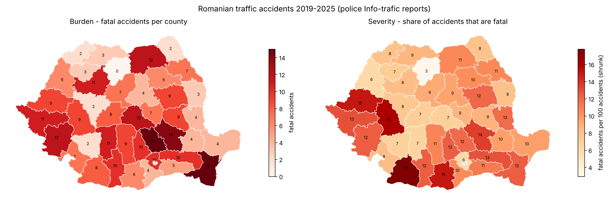

## Key findings

- **Who is involved matters most.** 37% of accidents involving a pedestrian are fatal (95% CI 29–45%)
  and 30% of those involving a cyclist, against 9.7% for all accidents.
- **Frontal collisions are the deadliest circumstance**: they multiply the odds of a fatal outcome by
  5.4, a pedestrian by 4.3 and a cyclist by 2.8. Rollovers (0.3×) are *less* often fatal than average.
- **Fatality can be predicted only moderately from the circumstances**: ROC-AUC 0.73, PR-AUC 0.27
  (2.8× better than chance).
- **Traffic resumption time can't be predicted from these reports**, because it is a rounded police
  estimate rather than a measured duration: 62% of the values are multiples of 15 minutes.
- Most fatal accidents happen on **DN 2, DN 1, DN 6 and DN 7**, the busiest national roads. Once
  accident volume is taken into account, most differences between roads and counties fall within
  their confidence intervals.

## Contents

- [Data](#data)
- [Pipeline](#pipeline)
- [Results](#results)
- [Dashboard](#dashboard)
- [How to run](#how-to-run)
- [Project structure](#project-structure)
- [Limitations](#limitations)
- [License and data](#license-and-data)

## Data

| | |
|---|---|
| Source | [politiaromana.ro – Info trafic](https://politiaromana.ro/ro/info-trafic), category "accidents" |
| Period | June 2019 – July 2025, continuous monthly coverage (plus one isolated report from 2017) |
| Raw reports | 3,881 → 3,867 after cleaning (duplicates and malformed pages removed) |
| Actual accidents | 3,271: the other reports are roadworks, vehicle fires, oversize transports, railway incidents |
| Fatal accidents | 317 (9.7%) |

Each report has a title (county, road), a date and time, a free-text description and an estimated
traffic resumption time. Everything else (deaths, injured, vehicles, circumstances) is **extracted
from the Romanian text** with rules in [`accidents/text.py`](accidents/text.py) and
[`accidents/features.py`](accidents/features.py). Those rules are covered by more than 100 tests that
use real sentences from the data.

| File | Content |
|---|---|
| `data/raw_reports.csv` | scraped reports, original Romanian columns |
| `data/accidents_clean.csv` | `timestamp, county, road, description, resumption_min` |
| `data/accidents_processed.csv` | + `vehicle_1..3`, `vehicle_1..3_count`, `vehicles_total`, `injured`, `deaths` |

## Pipeline

| Step | Script | Output |
|---|---|---|
| 1. Scrape (optional) | `scripts/scrape_data.py` | `data/raw_reports.csv` |
| 2. Clean | `scripts/clean_data.py` | county, road, resumption minutes, timestamp |
| 3. Extract | `scripts/process_data.py` | vehicles, injured, deaths |
| 4. EDA | `analysis/eda.py` | `visuals/eda/` |
| 5. Risk by road / county | `analysis/risk_analysis.py` | `visuals/risk/` |
| 6. Risk by vehicle / road user | `analysis/vehicle_analysis.py` | `visuals/vehicles/` |
| 7. Fatality classifier | `scripts/train_fatality_classifier.py` | `visuals/classification/`, `reports/` |
| 8. Resumption-time regressor | `scripts/train_resumption_regressor.py` | `visuals/regression/`, `reports/` |
| Dashboard | `dashboard/app.py` | Streamlit app |

`python run_pipeline.py` runs steps 2–8 in about 30 seconds. All metrics are written to `reports/*.json`
and all figures to `visuals/`.

**Tech stack:** Selenium and BeautifulSoup for scraping · pandas and regex for extraction ·
scikit-learn, XGBoost and Optuna for the models · SciPy for statistics · matplotlib, seaborn and Plotly
for charts · Streamlit for the dashboard · pytest for tests.

## Results

### 1. Which circumstances make an accident fatal?

The deaths are extracted from the same description as the features. To keep the label from leaking
into the inputs, the model uses only the **circumstances** of an accident, never outcome words; a
test enforces this. The circumstances are:
- time: hour, day, month, weekend
- county and road type
- number of vehicles
- 14 flags extracted from the text: pedestrian, cyclist, motorcycle, frontal collision, rollover,
  run-off-road, fixed obstacle, animal, railway, heavy vehicle, bus, fire, bad weather, skid

Four models were compared with 5-fold cross-validation on the training set (75%):

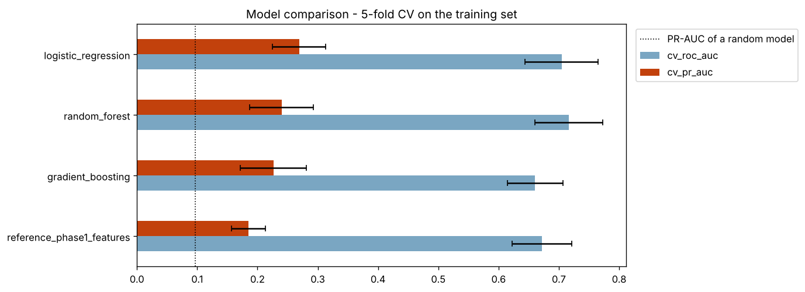

| Model | CV ROC-AUC | CV PR-AUC |
|---|---|---|
| **Logistic regression** (selected) | 0.704 | **0.269** |
| Random forest | 0.717 | 0.240 |
| Gradient boosting | 0.661 | 0.227 |
| Reference: first version's features (injured, resumption time, county, road) | 0.672 | 0.185 |

The selected model was then evaluated once, on the held-out test set:

| Test set (818 accidents, 79 fatal) | Value |
|---|---|
| ROC-AUC | **0.73** |
| PR-AUC | **0.27** (chance: 0.097) |
| Recall / precision for fatal accidents | 0.41 / 0.26 (threshold chosen on out-of-fold predictions) |

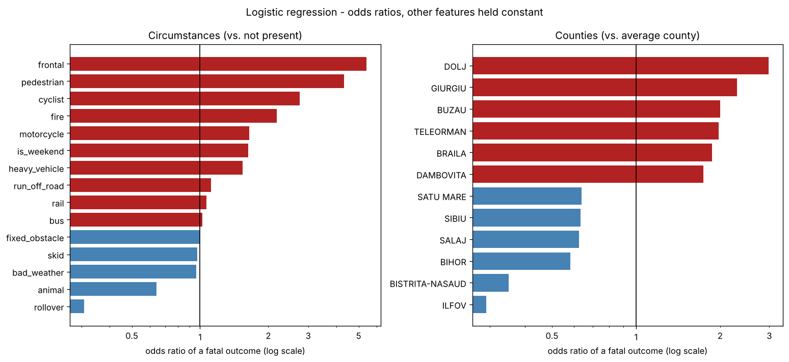

### 2. How often is an accident fatal, by road user?

Each accident counts once per vehicle type involved. The data does not say whose occupant died, so
the question answered is "when an accident involves X, how often is it fatal?":

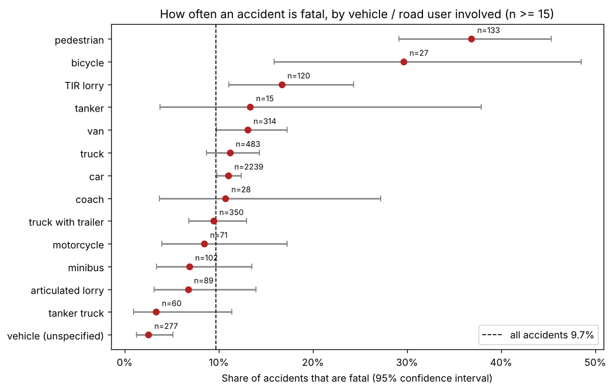

### 3. Roads and counties: burden vs. severity

- **Burden** is the number of fatal accidents. It shows where most deaths happen, which is largely
  where traffic is heaviest.
- **Severity** is the share of accidents that are fatal, with 95% Wilson confidence intervals. Roads
  and counties are ranked by a rate shrunk toward the national average, so that 1 fatal accident out
  of 2 does not top the list. Only groups with at least 30 accidents are ranked.

| Burden – roads | Severity – roads |
|---|---|
| 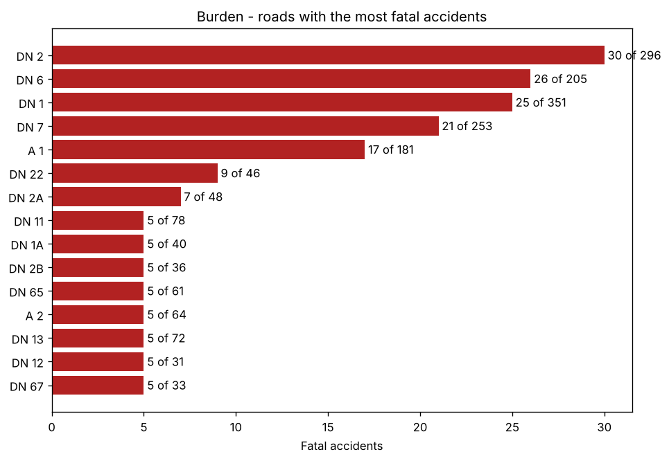 | 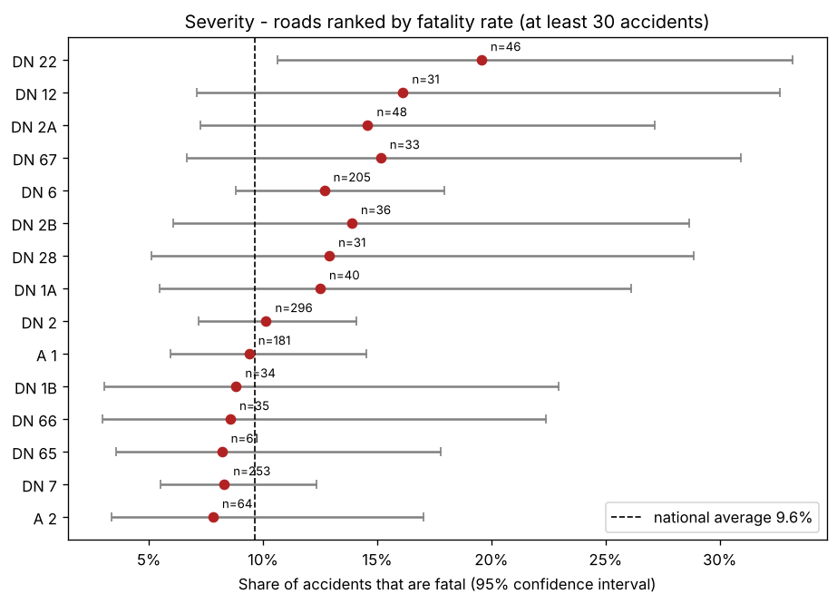 |

### 4. Traffic resumption time

XGBoost was tuned with Optuna on a separate validation set. Outliers (> 105 min) were removed using
bounds computed on the training data.

| Model (test set, 508 reports) | MAE (min) | RMSE (min) |
|---|---|---|
| Baseline: always predict the mean | 14.23 | 17.87 |
| XGBoost: deaths, injured, county, road, time | 13.93 | 17.60 |
| XGBoost: + circumstances | 13.87 | 17.60 |

The models barely beat a constant. The reason is the target: it is the police **estimate** written in
the report, not a measured duration. 62% of the values are multiples of 15 minutes and 28% are exactly
30 minutes.

### 5. When do accidents happen?

| By hour | Day × hour |
|---|---|
| 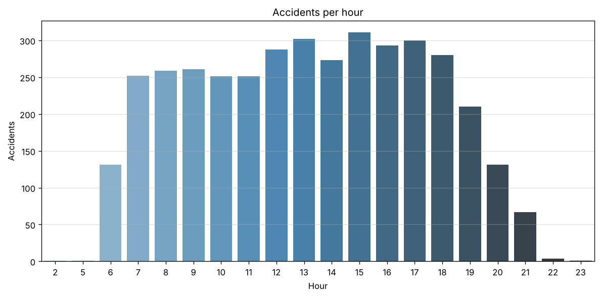 | 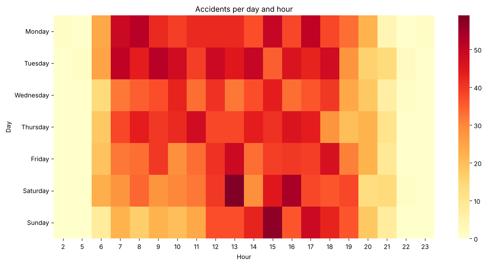 |

More figures:
- **EDA:** [per day](visuals/eda/accidents_per_day.png),
  [per month](visuals/eda/accidents_per_month.png),
  [per year](visuals/eda/accidents_per_year.png),
  [top counties](visuals/eda/top_counties.png), [top roads](visuals/eda/top_roads.png),
  [resumption time](visuals/eda/resumption_histogram.png)
- **Risk:** [county burden](visuals/risk/counties_burden.png),
  [county severity](visuals/risk/counties_severity.png),
  [vehicles in serious accidents](visuals/vehicles/vehicles_in_serious_accidents.png)
- **Classifier:** [ROC & PR curves](visuals/classification/roc_pr_curves.png),
  [confusion matrix](visuals/classification/confusion_matrix.png)
- **Regressor:** [model comparison](visuals/regression/model_comparison.png),
  [predicted vs. actual](visuals/regression/predicted_vs_actual.png),
  [feature importance](visuals/regression/feature_importance.png)

## Dashboard

```bash
streamlit run dashboard/app.py
```

- **Filters:** period, counties, road type, and whether to show accidents only.
- **KPIs:** accidents, fatal accidents, fatality rate, injured, median estimated resumption time.
- **Tabs:**
  - an interactive county map (accidents, fatal accidents or fatality rate)
  - time patterns
  - a road table
  - fatality rate by circumstance with confidence intervals
  - a searchable list of the original reports

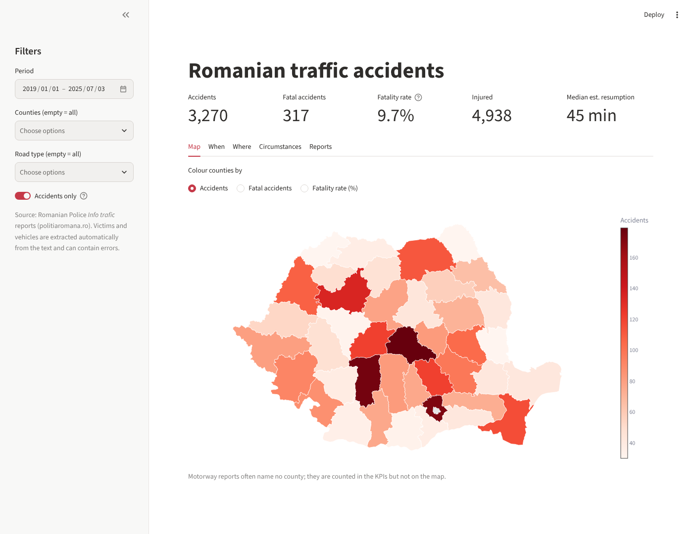

| When | Circumstances |
|---|---|
| 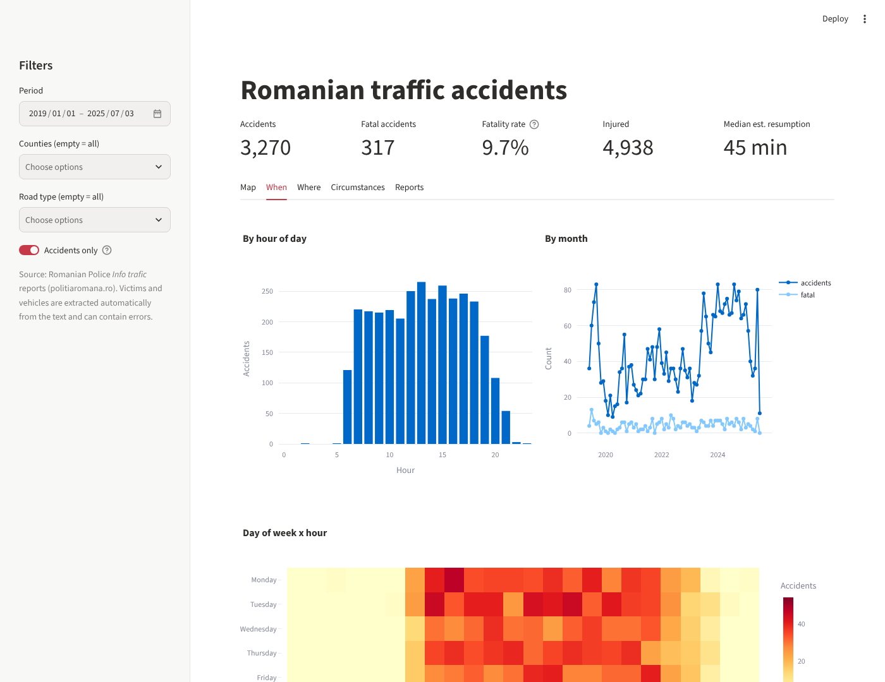 | 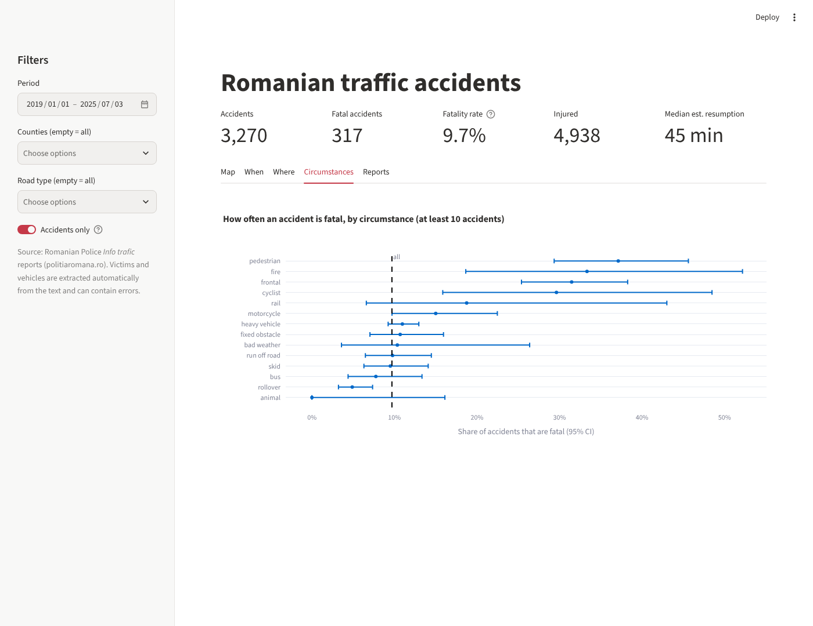 |

## How to run

Requires Python 3.13 (other recent versions will likely work).

```bash
pip install -r requirements-dev.txt
```

```bash
python run_pipeline.py
```

Options:
- `--skip-models`
- `--show`: also open every figure on screen
- `--scrape`: scrape the site again first

Each script can also be run on its own, from any working directory.

```bash
python -m pytest
```

The scraper needs Chrome; Selenium downloads a matching driver automatically. It overwrites its output
file unless `--append` is given:

```bash
python scripts/scrape_data.py --start-page 1 --end-page 5 --output data/sample.csv
```

With `make`: `make install-dev`, `make pipeline`, `make test`, `make dashboard`.

## Project structure

```
├── accidents/            shared package – every script imports from here
│   ├── config.py         paths, constants, county list, dictionaries
│   ├── text.py           text extraction (county, road, resumption, vehicles, victims)
│   ├── features.py       accident filter + circumstance features for the models
│   ├── data.py           loading + common filters
│   ├── stats.py          Wilson confidence intervals, shrunk rates
│   ├── geo.py            county boundaries, static and interactive maps
│   ├── plotting.py       saves figures to visuals/
│   └── scraping.py       HTML parsing for the police website
├── scripts/              scrape, clean, process, train the two models
├── analysis/             EDA, risk by road/county, risk by vehicle
├── dashboard/app.py      Streamlit app
├── tests/                pytest suite
├── data/                 CSVs + data/geo/romania_counties.geojson
├── visuals/              generated figures, one folder per analysis
├── reports/              generated model metrics (JSON)
├── run_pipeline.py       runs every step in order
├── Makefile
└── requirements.txt      pinned versions (requirements-dev.txt adds pytest)
```

## Limitations

- **Text extraction is rule-based.** Victims, vehicles and circumstances come from regular expressions
  on Romanian text. They are tested on real sentences and checked by hand on random samples, but
  unusual phrasings will be missed.
- **These are police "Info trafic" reports, not official accident statistics.** They cover incidents
  that affected traffic and were published. They do not cover all accidents in Romania, and deaths
  that occur later in hospital are not included.
- **There is no exposure data**, such as traffic volume or road length, so the "burden" figures largely
  reflect how busy a road is.
- **County effects can reflect reporting style.** Some counties' reports may simply describe accidents
  differently.
- **Reports are published mostly between 06:00 and 22:00**, so night accidents are under-represented.
- **Motorway reports rarely name a county**, so they appear in national figures but not on the maps.
- **The scraper was written for the site's structure in 2025** and may need updating if the site changes.

## License and data

The code is released under the [MIT License](LICENSE).

- The accident reports are public information published by the Romanian Police (Inspectoratul General
  al Poliției Române) and remain theirs; they are included here for research and education.
- County boundaries come from [click_that_hood](https://github.com/codeforgermany/click_that_hood)
  by Code for America (MIT License), simplified.

## Author

Alex Negulescu – [GitHub](https://github.com/AlexNegulescu111)
